# Ritual Roast Coffee on AWS: ECS Fargate, ECR and a CI/CD Pipeline

[](https://github.com/sumit-adkhale/AWS-ECS-ECR-with-Github-Actions-Pipeline/actions/workflows/deploy.yml)

A containerised PHP + Apache web app (a coffee voting site) deployed on **AWS ECS Fargate** in a three-tier VPC. Images live in **Amazon ECR**, the database is **RDS MySQL**, the database password lives in **Secrets Manager** with automatic 7-day rotation, and every push to `main` is built and deployed by **GitHub Actions** using OIDC (no stored AWS keys).

The application code comes from the IaaS Academy ECS course. This repository documents how I deployed it and added the CI/CD pipeline.

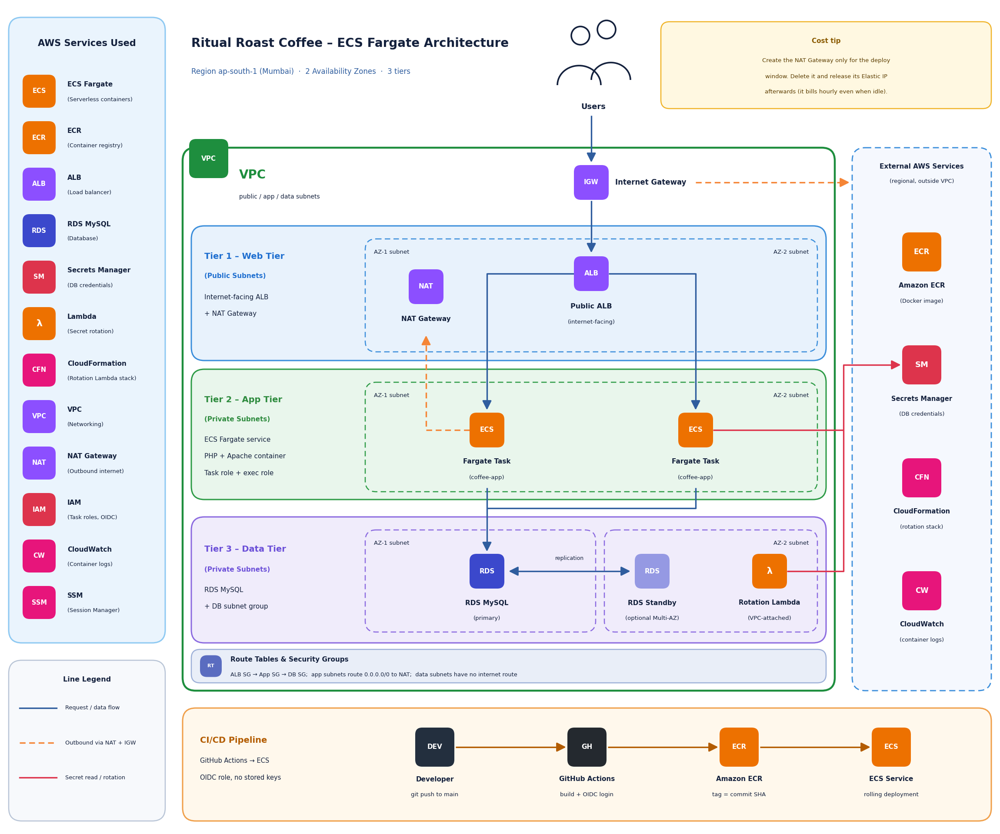

## Table of contents

1. [What this project demonstrates](#what-this-project-demonstrates)
2. [Architecture](#architecture)
3. [Tech stack](#tech-stack)
4. [Prerequisites](#prerequisites)
5. [Cost notes (read before you start)](#cost-notes-read-before-you-start)
6. [Part 1: Manual deployment](#part-1-manual-deployment)
7. [Part 2: CI/CD pipeline with GitHub Actions](#part-2-cicd-pipeline-with-github-actions)
8. [Clean-up (stop the billing)](#clean-up-stop-the-billing)
9. [Troubleshooting](#troubleshooting)
10. [Security notes](#security-notes)
11. [Future improvements](#future-improvements)

## What this project demonstrates

- A three-tier network design: public subnets (ALB), private app subnets (Fargate), private data subnets (RDS), across two Availability Zones.
- Least-privilege networking with chained security groups: `alb-sg` to `app-sg` to `rds-sg`.
- Containers on Fargate pulled from a private ECR repository.
- No passwords in code or environment variables: the app reads the DB credentials from Secrets Manager at runtime through an IAM role.
- Automatic credential rotation every 7 days with a VPC-attached Lambda function.
- Keyless CI/CD: GitHub Actions assumes an IAM role through OIDC, pushes an image tagged with the commit SHA, and triggers an ECS rolling deployment.
- Cost control: the NAT Gateway is created only when needed.

## Architecture

**Request flow:** Users reach the Internet Gateway, then the public Application Load Balancer. The ALB forwards HTTP traffic to Fargate tasks in the private app subnets. The tasks connect to RDS MySQL in the private data subnets.

**Outbound flow:** Tasks in private subnets have no public IP. To pull images from ECR, read the secret and write logs, they go out through the NAT Gateway (in a public subnet) and the Internet Gateway.

**Secrets flow:** The task reads the DB credentials from Secrets Manager using its IAM role. Every 7 days Secrets Manager invokes a rotation Lambda, which changes the password in RDS and updates the secret. The Lambda is deployed by a CloudFormation stack that the console creates when you enable rotation.

**Delivery flow:** `git push` to `main` starts GitHub Actions, which builds the image, pushes it to ECR tagged with the commit SHA, registers a new task definition revision and updates the ECS service.

| Tier | Subnets | Resources | Security group |
|---|---|---|---|
| Web | Public (2 AZs) | ALB, NAT Gateway | `alb-sg` |
| App | Private (2 AZs) | ECS Fargate tasks | `app-sg` |
| Data | Private (2 AZs) | RDS MySQL | `rds-sg` |

## Tech stack

| Area | Technology |
|---|---|
| App | PHP 7.4 + Apache, MySQL (mysqli), AWS SDK for PHP (bundled in `vendor/`) |
| Containers | Docker, Amazon ECR, Amazon ECS on Fargate |
| Network | VPC, public/private subnets, Internet Gateway, NAT Gateway, ALB |
| Data | Amazon RDS for MySQL |
| Secrets | AWS Secrets Manager, rotation Lambda (CloudFormation-deployed) |
| Access | IAM roles, Systems Manager Session Manager |
| CI/CD | GitHub Actions, GitHub OIDC |
| Logs | Amazon CloudWatch Logs |

## Prerequisites

- An AWS account and a user or role that can create the resources above.
- Region used throughout: **ap-south-1 (Mumbai)**. Use one region for everything; mixing regions causes confusing errors.
- A GitHub account and a repository containing the application code (the folder with the `Dockerfile` is the Docker build context).
- Basic familiarity with the AWS console. Every step below has a short checkpoint so you can confirm it worked before moving on.

> **Placeholders.** Replace `<ACCOUNT_ID>` with your 12-digit AWS account ID and use your own resource names where they differ. Never commit real secrets, keys or passwords to the repository.

## Cost notes (read before you start)

Several of these resources are **not** covered by the AWS free tier or bill while idle. Check the current prices on the AWS pricing pages and set a billing alarm before you begin.

| Resource | Note |
|---|---|
| NAT Gateway | Bills per hour (roughly $0.045/hour at us-east-1 rates, which is about $32/month) plus per-GB data processing, even with no traffic. **Not part of the free tier.** |
| Elastic IP / public IPv4 | Billed hourly. An Elastic IP left allocated after deleting the NAT Gateway keeps billing. |
| Application Load Balancer | Billed hourly plus usage. |
| RDS | Free-tier eligibility depends on your account and instance type. Use a small single-AZ instance. |
| Secrets Manager | Billed per secret per month after a free trial period. |

**How this project saves money:** the NAT Gateway is created at the end, just before the ECS service, and deleted when you finish testing. If you want the app to stay online cheaply, an alternative is to run the tasks in public subnets with a public IP and strict security groups. This repository keeps the tasks private, as in the architecture diagram.

---

## Part 1: Manual deployment

Follow the steps in order. Do not create the NAT Gateway until step 11.

### Step 1: Create the VPC

Create a VPC across **two Availability Zones** with **six subnets**:

| Subnet | Count | Route table |
|---|---|---|
| Public | 2 (one per AZ) | `0.0.0.0/0` to the Internet Gateway |
| Private app | 2 (one per AZ) | Local only for now (NAT is added in step 11) |
| Private data | 2 (one per AZ) | Local only, no internet route at all |

Use clear names such as `coffee-app-public-a`, `coffee-app-app-a`, `coffee-app-data-a`. When using the "VPC and more" wizard, set **NAT gateways: None**. The wizard creates only public and private subnets, so add the second private pair (data) yourself.

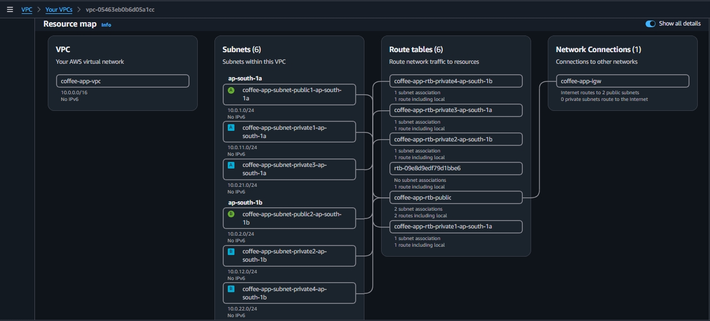

> **Cost note:** NAT is intentionally skipped here. It is created in step 11.

**Checkpoint:** the VPC shows 6 subnets in 2 AZs and an Internet Gateway attached.

### Step 2: Create the security groups

Create three security groups in the VPC. Each tier accepts traffic only from the tier in front of it.

| Security group | Inbound port | Source | Purpose |
|---|---|---|---|
| `alb-sg` | 80 (HTTP) | `0.0.0.0/0` | Public traffic to the load balancer |
| `app-sg` | 80 (HTTP) | `alb-sg` | Only the ALB can reach the tasks |
| `rds-sg` | 3306 (MySQL) | `app-sg` | Tasks (and the temporary EC2 used for DB setup) reach the database |
| `rds-sg` | 3306 (MySQL) | `rds-sg` (itself) | The rotation Lambda, which uses `rds-sg`, reaches the database |

Leave the default outbound rule (all traffic) on all three groups.

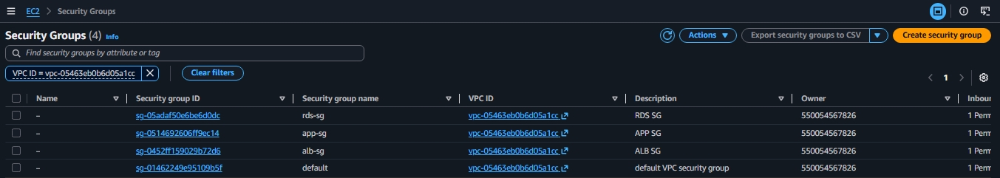

**Checkpoint:** `rds-sg` has two inbound rules (one from `app-sg`, one from itself).

### Step 3: Create the ECR repository

Go to **ECR, Private registry, Repositories, Create repository**. Name it `coffee-app` and keep the default settings.

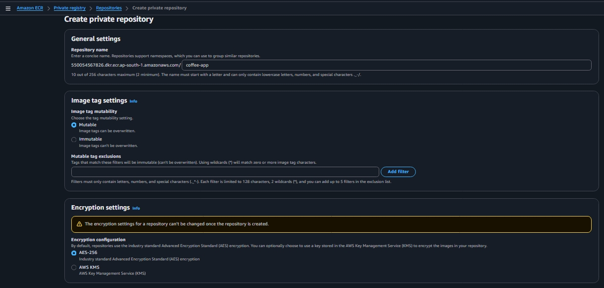

**Checkpoint:** the repository exists in `ap-south-1` and you can see its URI: `<ACCOUNT_ID>.dkr.ecr.ap-south-1.amazonaws.com/coffee-app`.

### Step 4: Build the Docker image and push it to ECR

You need a machine with Docker and permission to push to ECR. This project uses a **temporary EC2 instance** and connects with Session Manager, so no SSH key or open port is needed.

#### 4.1 Create an IAM role for the temporary EC2 instance

**IAM, Roles, Create role**, trusted entity **EC2**, then attach:

| Policy | Why |
|---|---|
| `EC2InstanceProfileForImageBuilderECRContainerBuilds` | Broad permissions to push images to ECR |
| `AmazonSSMManagedInstanceCore` | Lets Session Manager connect to the instance |

Name it, for example, `temp-ec2-ecr-builder-role`.

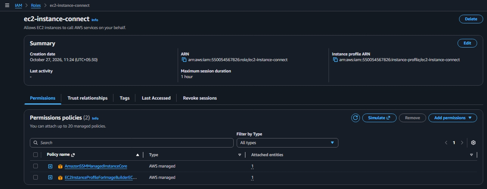

#### 4.2 Launch the temporary EC2 instance

| Setting | Value |
|---|---|
| AMI | Amazon Linux 2023 |
| Instance type | `t3.micro` (or a free-tier eligible type) |
| Key pair | Proceed without a key pair |
| IAM instance profile | The role from 4.1 |

Pick the network based on whether you already have a NAT Gateway:

| Situation | Network settings |
|---|---|
| **No NAT yet (this project's approach)** | Use the **default VPC** with a public subnet and **auto-assign public IP enabled**, so the instance can reach SSM, the package repositories, GitHub and ECR. |
| NAT already created | Use your VPC, a **private app subnet**, no public IP, and `app-sg`. |

> An instance in a private subnet with no NAT or VPC endpoints cannot reach Systems Manager, so it will show "not connected" in Session Manager.

#### 4.3 Connect with Session Manager

Select the instance, click **Connect**, choose the **Session Manager** tab, then switch to the standard user:

```bash
sudo su - ec2-user
```

If the Connect button is greyed out or says "not connected", wait 2 to 5 minutes and check **Systems Manager, Fleet Manager** for the instance showing as **Online**. See [Troubleshooting](#troubleshooting) if it does not.

#### 4.4 Install Docker and Git

```bash
sudo dnf update -y
sudo dnf install -y docker git
sudo systemctl enable --now docker
sudo usermod -aG docker ec2-user
```

Log out and reconnect (or run `sudo reboot` and reconnect) so the group change takes effect. Then check:

```bash
docker ps
```

#### 4.5 Get the code

```bash
git clone https://github.com/sumit-adkhale/AWS-ECS-ECR-with-Github-Actions-Pipeline.git
cd AWS-ECS-ECR-with-Github-Actions-Pipeline/
ls
```

The folder you are in must contain the `Dockerfile`.

> **Fix the Dockerfile first.** The base image `php:7.4-apache` is built on an old Debian release whose security repository no longer serves packages, so this line makes the build fail with `404 Not Found`:
>
> ```dockerfile
> RUN apt-get update && apt-get upgrade -y
> ```
>
> Delete that line. The `mysqli` extension is installed on the line before it, and the app does not need the upgrade. Your Dockerfile should look like this:
>
> ```dockerfile
> FROM php:7.4-apache
>
> RUN docker-php-ext-install mysqli && docker-php-ext-enable mysqli
>
> COPY . /var/www/html
> EXPOSE 80
> ```

#### 4.6 Build, authenticate and push

You can copy the exact commands from **ECR, your repository, View push commands**. They are:

```bash
export AWS_REGION=ap-south-1
export ACCOUNT_ID=$(aws sts get-caller-identity --query Account --output text)
export REPO=$ACCOUNT_ID.dkr.ecr.$AWS_REGION.amazonaws.com/coffee-app

# Build
docker build -t $REPO:latest .
docker images

# Authenticate Docker to ECR
aws ecr get-login-password --region $AWS_REGION | docker login --username AWS --password-stdin $ACCOUNT_ID.dkr.ecr.$AWS_REGION.amazonaws.com

# Push
docker push $REPO:latest
```

> If `aws sts get-caller-identity` fails with `NoCredentials`, the IAM role is not attached to the instance. Attach it under **Actions, Security, Modify IAM role**, wait a minute and try again.

**Checkpoint:** the image appears in the ECR repository with the tag `latest`. You can now **terminate the temporary instance** (you will launch another small one later only if you need to initialise the database).

### Step 5: Create the DB subnet group

**RDS, Subnet groups, Create DB subnet group.** Select your VPC, choose both Availability Zones, and select only the two **data** subnets. Name it `coffee-app-db-subnet-group`.

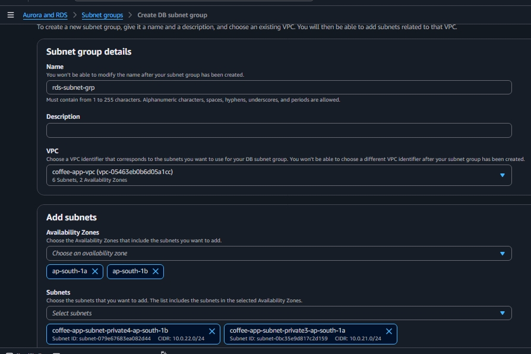

### Step 6: Create the RDS database

**RDS, Databases, Create database.**

| Setting | Value |
|---|---|
| Engine | MySQL |
| Template | Dev/Test or Free tier (single instance, no Multi-AZ) |
| DB instance identifier | `coffee-app-db` |
| Instance class | `db.t4g.micro` |
| Master username / password | Choose your own; store the password safely (it goes into Secrets Manager in step 7) |
| VPC / subnet group | Your VPC and `coffee-app-db-subnet-group` |
| Public access | **No** |
| Security group | `rds-sg` (remove the default one) |
| **Initial database name** (under Additional configuration) | `coffee-app-db` |

> **Set the initial database name.** The app expects a database that already exists and only creates its table, not the database itself. If you skip this field, the form fails later with `Unknown database 'coffee-app-db'`. Step 16 shows how to create it afterwards if you forgot.

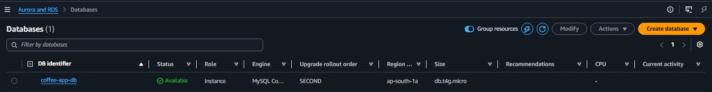

**Checkpoint:** the instance status is **Available**. Copy the **endpoint** (hostname) for the task definition.

### Step 7: Store the credentials in Secrets Manager and enable rotation

**Secrets Manager, Secrets, Store a new secret.**

1. Secret type: **Credentials for Amazon RDS database**. Enter the master username and password, then select the `coffee-app-db` instance.
2. Secret name: `coffee-app-secret`.
3. Enable **automatic rotation**, schedule **every 7 days**, and choose to **create a rotation function**.

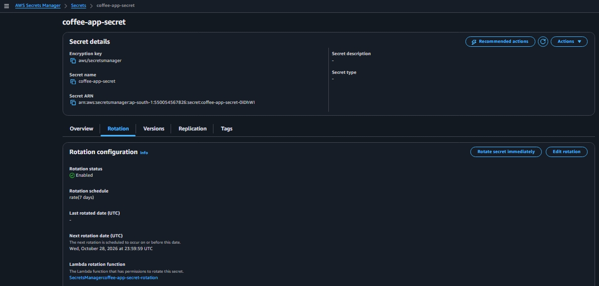

When you enable rotation, the console starts a **CloudFormation stack** that deploys the **rotation Lambda function**. CloudFormation only creates the Lambda, its IAM role and its permissions once. Every 7 days after that, Secrets Manager invokes the Lambda directly, and the Lambda generates a new password, sets it in RDS, tests it, and marks it as current.

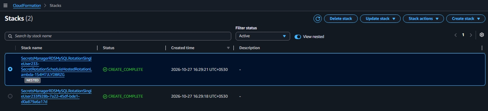

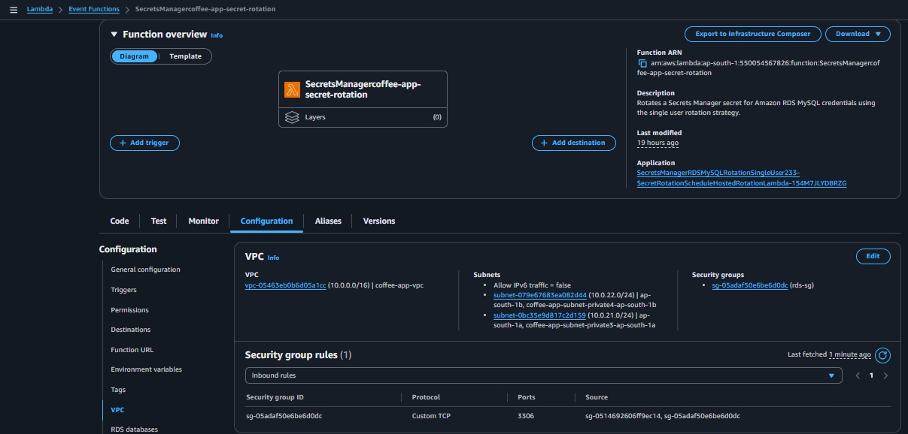

> **Do not delete the CloudFormation stack** while rotation is enabled, or the Lambda disappears and rotation fails. The rotation Lambda runs inside your VPC and needs a route to the Secrets Manager API (the NAT Gateway from step 11, or a Secrets Manager VPC endpoint). Until then, a manual "Rotate secret immediately" will time out.

### Step 8: Create the target group

**EC2, Target groups, Create target group.**

| Setting | Value |
|---|---|
| Target type | **IP addresses** (required for Fargate) |
| Name | `coffee-app-tg` |
| Protocol / port | HTTP / 80 |
| VPC | Your VPC |
| Health check path | `/health.html` (a static file included in the app) |

Do not register targets now. ECS registers the tasks automatically when the service starts.

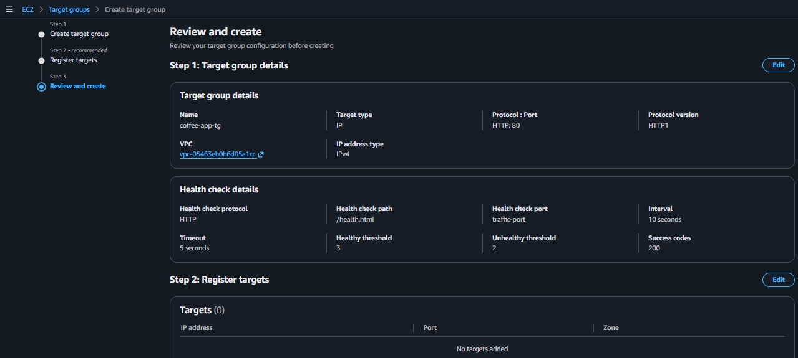

### Step 9: Create the Application Load Balancer

**EC2, Load balancers, Create load balancer, Application Load Balancer.**

| Setting | Value |
|---|---|
| Name | `coffee-app-alb` |
| Scheme | Internet-facing, IPv4 |
| Network | Your VPC, both **public** subnets |
| Security group | `alb-sg` |
| Listener | HTTP : 80, forward to `coffee-app-tg` |

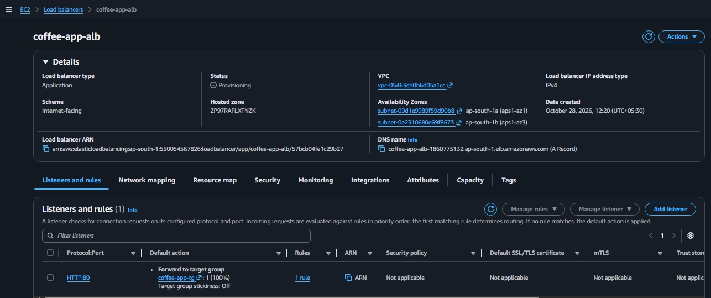

**Checkpoint:** the ALB state is **Active**. It shows 503 until the ECS service is running, which is expected.

### Step 10: Create the IAM policy and role for the ECS tasks

#### 10.1 Custom policy that allows reading the secret

**IAM, Policies, Create policy, JSON.** Name it `coffee-app-allow-read-rds-secret-policy`:

```json
{
  "Version": "2012-10-17",
  "Statement": [
    {
      "Effect": "Allow",
      "Action": [
        "secretsmanager:GetSecretValue",
        "secretsmanager:DescribeSecret"
      ],
      "Resource": "arn:aws:secretsmanager:ap-south-1:<ACCOUNT_ID>:secret:coffee-app-secret-*"
    }
  ]
}
```

The trailing `-*` is needed because Secrets Manager adds a random suffix to the secret's ARN.

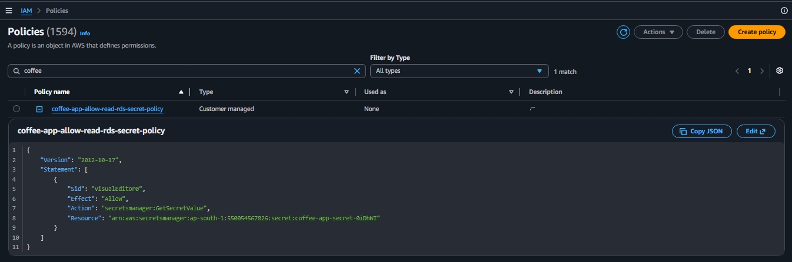

#### 10.2 IAM role for the ECS tasks

**IAM, Roles, Create role**, trusted entity **Elastic Container Service Task**. Attach:

- `AmazonECSTaskExecutionRolePolicy` (pull the image from ECR, write logs)
- `coffee-app-allow-read-rds-secret-policy` (read the DB secret)

Name it `coffee-app-ecs-task-role`.

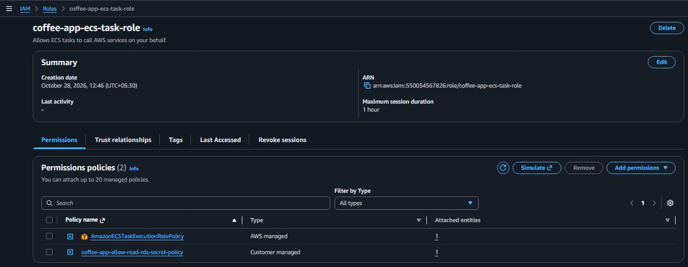

> This project uses one role as both the **task role** (what the app can do) and the **task execution role** (what ECS needs to start the task). It is simple and works. In production, use two separate roles so the application code does not get the execution permissions.

### Step 11: Create the NAT Gateway and update the route tables

Create the NAT Gateway **now**, right before the ECS service, so you only pay while you need it.

**VPC, NAT gateways, Create NAT gateway:**

| Setting | Value |
|---|---|
| Name | `coffee-app-nat` |
| Subnet | One of the **public** subnets (for example AZ-A) |
| Connectivity type | Public |
| Elastic IP | Allocate a new Elastic IP |

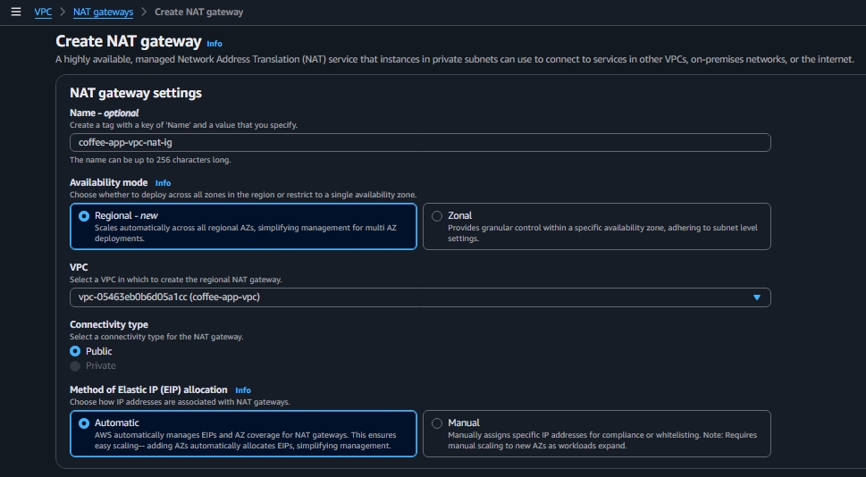

Then add this route to the route table of **both** private app subnets (if each subnet has its own route table, edit both; if they share one, edit it once):

| Destination | Target |
|---|---|
| `0.0.0.0/0` | The NAT Gateway |

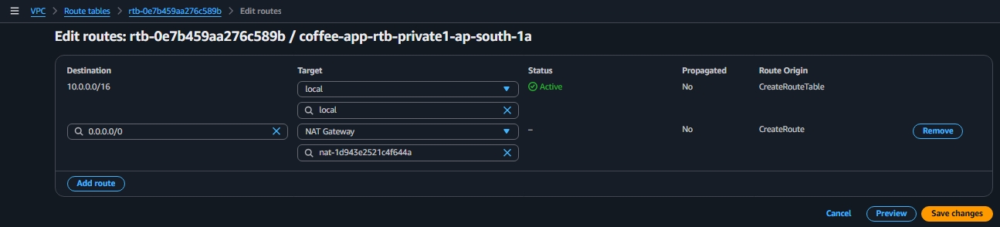

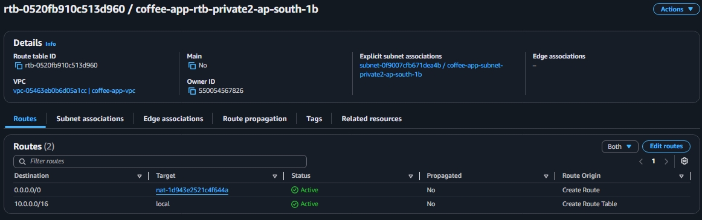

Both subnets need the route because ECS places tasks in both AZs. If only one has it, tasks that land in the other subnet fail to pull the image. Leave the **data** subnets without an internet route.

**Checkpoint:** the NAT Gateway state is **Available**, and both app route tables show `0.0.0.0/0` pointing to it.

### Step 12: Create the ECS cluster

**ECS, Clusters, Create cluster.** Name it `coffee-app-ecs-cluster` and keep **AWS Fargate (serverless)** as the infrastructure.

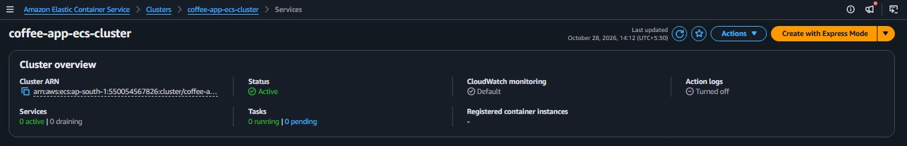

### Step 13: Create the ECS task definition

**ECS, Task definitions, Create new task definition.**

| Setting | Value |
|---|---|
| Family | `coffee-app-task-definition` |
| Launch type | AWS Fargate |
| OS / architecture | Linux / X86_64 |
| Task size | 0.5 vCPU, 1 GB memory |
| Task role | `coffee-app-ecs-task-role` |
| Task execution role | `coffee-app-ecs-task-role` |
| Container name | `Main` |
| Image URI | `<ACCOUNT_ID>.dkr.ecr.ap-south-1.amazonaws.com/coffee-app:latest` |
| Container port | 80, TCP, HTTP |
| Logging | Amazon CloudWatch, log group `/ecs/coffee-app-task-definition`, region `ap-south-1`, stream prefix `ecs`, create group `true` |

**Environment variables** (the app reads these in `db_config.php`):

| Key | Value |
|---|---|
| `AWS_REGION` | `ap-south-1` (**lowercase, exactly**) |
| `SECRET_NAME` | `coffee-app-secret` |
| `DB_SERVER` | Your RDS endpoint, for example `coffee-app-db.xxxxxxxx.ap-south-1.rds.amazonaws.com` |
| `DB_DATABASE` | `coffee-app-db` |

> **Common mistake:** a wrong `AWS_REGION` such as `AP-SOUTH-1` produces the error `Credential should be scoped to a valid region` from Secrets Manager. Retype the value by hand with no spaces.

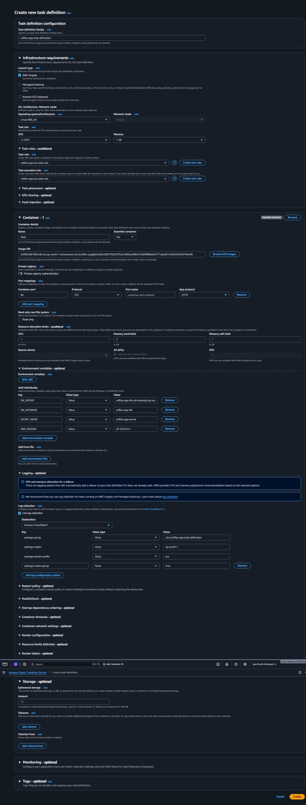

> The screenshots in this guide were taken with the original resource names (the family was spelled `coffee-app-task-defination`). Use whatever names you choose, and make sure the same names appear in the CI/CD workflow later.

### Step 14: Create the ECS service

**ECS, Clusters, `coffee-app-ecs-cluster`, Services, Create.**

| Setting | Value |
|---|---|
| Task definition | Your family, latest revision |
| Compute | Launch type: Fargate, platform version LATEST |
| Scheduling | Replica, desired tasks: 1 |
| Networking: VPC | Your VPC |
| Networking: subnets | Both **private app** subnets |
| Networking: security group | `app-sg` |
| Networking: public IP | **Turned off** |
| Load balancing | Application Load Balancer, use the existing `coffee-app-alb` |
| Container to load balance | `Main : 80` |
| Listener | Existing listener `HTTP:80` |
| Target group | Existing `coffee-app-tg` |
| Health check grace period | 30 to 60 seconds (gives the app time to start) |
| Service auto scaling (optional) | Min 1, max 4, policy `ECSServiceAverageCPUUtilization`, target 70, cooldowns 300 s |

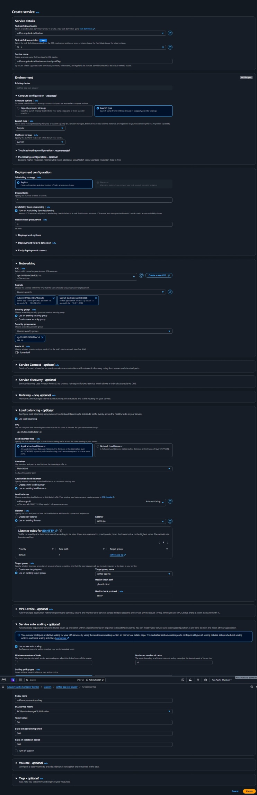

**Checkpoint:** the service shows `1/1` tasks **Running**, and in the target group the target is **Healthy**. If a task stops immediately, open the stopped task and read the **Stopped reason**, then check the [troubleshooting table](#troubleshooting).

### Step 15: Test the application

**EC2, Load balancers, `coffee-app-alb`**, copy the **DNS name**, and open it in a browser using **`http://`** (not `https://`, because the listener is HTTP only).

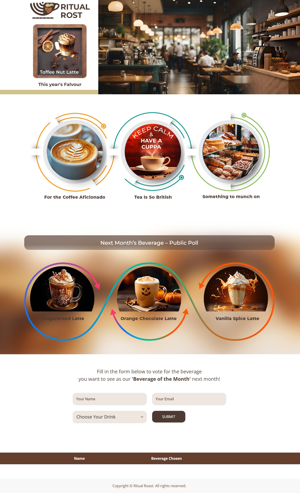

Submit the voting form. If it does not respond, go to step 16.

### Step 16: Troubleshooting step for the form: create the database if it is missing

If the form does nothing, open the browser **DevTools, Network** tab, submit the form and click `submit_beverage_voting.php`. The response is often a PHP error. If it says `Unknown database 'coffee-app-db'`, the database does not exist yet inside MySQL (the RDS instance identifier is only the server's name in AWS, not a database). Create it from a small helper instance:

1. Launch an EC2 instance (Amazon Linux 2023, `t3.micro`) in a **private app subnet** with **`app-sg`** (so `rds-sg` already trusts it) and the IAM role `AmazonSSMManagedInstanceCore`. The NAT route from step 11 gives it access to Systems Manager.
2. Wait 2 to 5 minutes until it shows **Online** in **Systems Manager, Fleet Manager**.
3. Connect through **EC2, Connect, Session Manager**.
4. Install the client and connect, using the username and password from **Secrets Manager, `coffee-app-secret`, Retrieve secret value** (use this, because rotation may have changed the original password):

   ```bash
   sudo dnf install -y mariadb105
   mysql -h <your-rds-endpoint> -u <username> -p
   ```

5. Create and confirm the database (the backticks are required because the name contains hyphens):

   ```sql
   CREATE DATABASE `coffee-app-db`;
   SHOW DATABASES;
   ```

6. Submit the form again. The app creates the `beverage_voting` table automatically on the first request.
7. **Terminate the helper instance** when you are done.

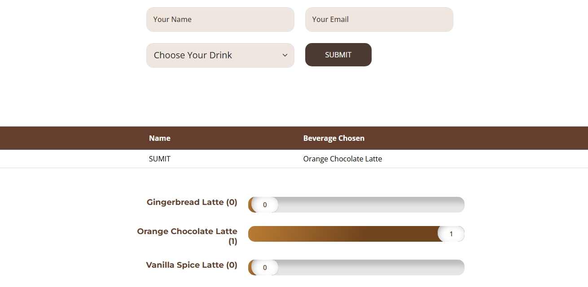

---

## Part 2: CI/CD pipeline with GitHub Actions

**Do this only after the manual deployment works.** Otherwise you will debug the pipeline and the infrastructure at the same time.

```
git push (main) -> GitHub Actions -> build image -> push to ECR (tag = commit SHA)
-> new task definition revision -> update ECS service -> wait until stable
```

> **The NAT Gateway must be running during deployments.** The pipeline itself needs no NAT (GitHub pushes to ECR over the internet), but every new task has to pull the image and read the secret from inside the private subnets.

### 1. Prepare the repository

Your repository should look like this (the `Dockerfile` is in the repository root in this project; if your code is in a subfolder, see the note under the workflow):

```
.
├── .aws/
│   └── task-definition.json
├── .github/
│   └── workflows/
│       └── deploy.yml
├── Dockerfile
├── index.html, *.php, assets/, vendor/ ...
└── README.md
```

1. In **ECS, Task definitions, your family, latest revision, JSON tab**, copy the JSON into `.aws/task-definition.json`. It contains no secrets because the password lives in Secrets Manager.
2. Delete the read-only fields that ECS adds, so registration does not fail: `taskDefinitionArn`, `revision`, `status`, `requiresAttributes`, `compatibilities`, `registeredAt`, `registeredBy`.
3. Note your exact **cluster name**, **service name** (ECS generates a suffix, for example `coffee-app-task-definition-service-xxxxxxxx`) and **container name** (`Main`). The names are case-sensitive.

### 2. Let GitHub access AWS without access keys (OIDC)

**IAM, Identity providers, Add provider, OpenID Connect:**

| Setting | Value |
|---|---|
| Provider URL | `https://token.actions.githubusercontent.com` |
| Audience | `sts.amazonaws.com` |

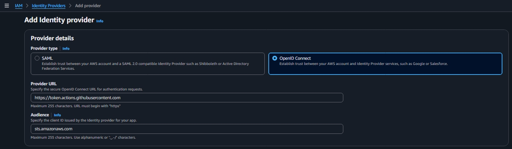

### 3. Create the IAM role for GitHub Actions

**IAM, Roles, Create role, Custom trust policy** (this is a separate role from the ECS task role). Use a trust policy that allows only your repository and the `main` branch:

```json
{
  "Version": "2012-10-17",
  "Statement": [
    {
      "Effect": "Allow",
      "Principal": {
        "Federated": "arn:aws:iam::<ACCOUNT_ID>:oidc-provider/token.actions.githubusercontent.com"
      },
      "Action": "sts:AssumeRoleWithWebIdentity",
      "Condition": {
        "StringEquals": {
          "token.actions.githubusercontent.com:aud": "sts.amazonaws.com",
          "token.actions.githubusercontent.com:sub": "repo:<OWNER>/<REPO>:ref:refs/heads/main"
        }
      }
    }
  ]
}
```

> **The `sub` value must match exactly what GitHub sends.** In this project GitHub's token included the numeric account and repository IDs, so the working value had this shape:
>
> `repo:<OWNER>@<OWNER_ID>/<REPO>@<REPO_ID>:ref:refs/heads/main`
>
> If the workflow fails with `Not authorized to perform sts:AssumeRoleWithWebIdentity`, open **CloudTrail, Event history, Event name = `AssumeRoleWithWebIdentity`** and copy the exact subject from the failed event into the trust policy.

Create a **custom permissions policy** (least privilege: one repository, one service) and attach it to the role:

```json
{
  "Version": "2012-10-17",
  "Statement": [
    { "Effect": "Allow", "Action": "ecr:GetAuthorizationToken", "Resource": "*" },
    {
      "Effect": "Allow",
      "Action": [
        "ecr:BatchCheckLayerAvailability",
        "ecr:InitiateLayerUpload",
        "ecr:UploadLayerPart",
        "ecr:CompleteLayerUpload",
        "ecr:PutImage",
        "ecr:BatchGetImage"
      ],
      "Resource": "arn:aws:ecr:ap-south-1:<ACCOUNT_ID>:repository/coffee-app"
    },
    {
      "Effect": "Allow",
      "Action": ["ecs:RegisterTaskDefinition", "ecs:DescribeTaskDefinition"],
      "Resource": "*"
    },
    {
      "Effect": "Allow",
      "Action": ["ecs:UpdateService", "ecs:DescribeServices"],
      "Resource": "arn:aws:ecs:ap-south-1:<ACCOUNT_ID>:service/<CLUSTER_NAME>/<SERVICE_NAME>"
    },
    {
      "Effect": "Allow",
      "Action": "iam:PassRole",
      "Resource": "arn:aws:iam::<ACCOUNT_ID>:role/coffee-app-ecs-task-role"
    }
  ]
}
```

`iam:PassRole` must list **every role named in the task definition** (task role and task execution role). Here both are the same role, so one ARN is enough. If you split them later, list both.

### 4. Add the role ARN to GitHub

In the repository: **Settings, Secrets and variables, Actions, New repository secret**, name `AWS_ROLE_ARN`, value the ARN of the role from step 3.

### 5. Add the workflow

Create `.github/workflows/deploy.yml`:

```yaml
name: Deploy to ECS

on:
  push:
    branches: [main]

permissions:
  id-token: write
  contents: read

env:
  AWS_REGION: ap-south-1
  ECR_REPOSITORY: coffee-app
  ECS_CLUSTER: coffee-app-ecs-cluster
  ECS_SERVICE: <your-service-name>
  CONTAINER_NAME: Main
  TASK_DEFINITION: .aws/task-definition.json

jobs:
  deploy:
    runs-on: ubuntu-latest
    steps:
      - uses: actions/checkout@v4

      - uses: aws-actions/configure-aws-credentials@v4
        with:
          role-to-assume: ${{ secrets.AWS_ROLE_ARN }}
          aws-region: ${{ env.AWS_REGION }}

      - id: ecr-login
        uses: aws-actions/amazon-ecr-login@v2

      - name: Build and push image
        id: build
        env:
          REGISTRY: ${{ steps.ecr-login.outputs.registry }}
          IMAGE_TAG: ${{ github.sha }}
        run: |
          docker build -t $REGISTRY/$ECR_REPOSITORY:$IMAGE_TAG .
          docker push $REGISTRY/$ECR_REPOSITORY:$IMAGE_TAG
          echo "image=$REGISTRY/$ECR_REPOSITORY:$IMAGE_TAG" >> $GITHUB_OUTPUT

      - id: render
        uses: aws-actions/amazon-ecs-render-task-definition@v1
        with:
          task-definition: ${{ env.TASK_DEFINITION }}
          container-name: ${{ env.CONTAINER_NAME }}
          image: ${{ steps.build.outputs.image }}

      - uses: aws-actions/amazon-ecs-deploy-task-definition@v2
        with:
          task-definition: ${{ steps.render.outputs.task-definition }}
          service: ${{ env.ECS_SERVICE }}
          cluster: ${{ env.ECS_CLUSTER }}
          wait-for-service-stability: true
```

What to adjust:

| Item | What to check |
|---|---|
| `ECS_SERVICE`, `ECS_CLUSTER`, `CONTAINER_NAME` | Must match the real names exactly (case-sensitive) |
| `branches: [main]` | Change to `master` if that is your default branch, and match it in the IAM trust policy |
| `docker build ... .` | If the `Dockerfile` is inside a subfolder, replace the final `.` with that folder's path |
| `.aws/task-definition.json` | Must exist at that exact path in the repository |

Images are tagged with the **commit SHA**, not only `latest`, so every deployment is traceable and you can roll back by deploying an older SHA.

### 6. Test the pipeline

1. Make a small visible change, such as editing text in `index.html`.
2. Commit and push to `main`.
3. Watch the **Actions** tab. Each step should turn green. Then check **ECS, service, Deployments** for the rolling update.
4. Refresh the website to see the change.

Before the change:

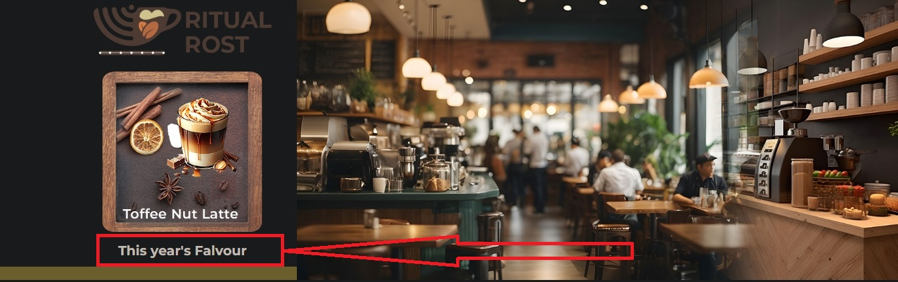

After the commit, GitHub starts the deployment:

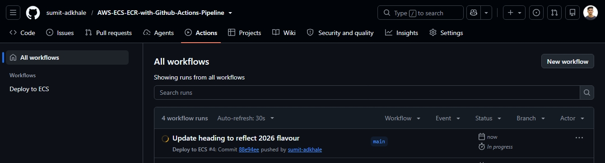

After the deployment finishes, the change is live:

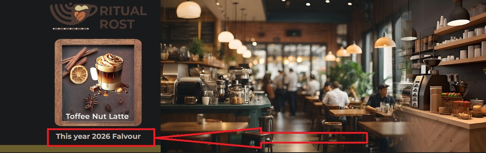

> A GitHub **Re-run** uses the workflow file as it was at the original commit. After editing the workflow, push a **new commit** instead of re-running the old run.

---

## Clean-up (stop the billing)

Delete in this order so nothing blocks the next deletion:

1. **ECS service** (set desired tasks to 0, then delete), then the **ECS cluster**.
2. **Application Load Balancer**, then the **target group**.
3. **NAT Gateway**, then **release its Elastic IP** (an allocated, unattached Elastic IP still bills).
4. **RDS instance** (skip the final snapshot if you do not need it), then the **DB subnet group**.
5. **Secret** in Secrets Manager, then the **CloudFormation stack** for the rotation Lambda (this removes the Lambda and its role).
6. **ECR images / repository**.
7. **IAM roles and policies** created for this project (task role, GitHub Actions role, temporary EC2 role) and the **OIDC provider** if nothing else uses it.
8. **Security groups, subnets, route tables, Internet Gateway and the VPC**.
9. Any **temporary EC2 instances** left running.

If you only want to pause costs but keep the setup, delete just the **NAT Gateway** (and release the Elastic IP) and set the ECS service to 0 tasks. Recreate the NAT and add the route again before the next deployment.

---

## Troubleshooting

| Symptom | Likely cause | Fix |
|---|---|---|
| `docker build` fails with `404 Not Found` during `apt-get upgrade` | The base image's Debian security repository no longer serves packages | Remove `RUN apt-get update && apt-get upgrade -y` from the `Dockerfile` |
| `aws ecr get-login-password` fails with `NoCredentials`, then `docker login` says "Cannot perform an interactive login from a non TTY device" | No AWS credentials on the machine | Attach an IAM role to the EC2 instance (or run `aws configure`); check with `aws sts get-caller-identity` |
| Session Manager says the instance is **not connected** | Missing `AmazonSSMManagedInstanceCore` role, no network path to SSM, or the agent is not running | Attach the role; use a public subnet with a public IP, a private subnet with NAT, or the three VPC endpoints (`ssm`, `ssmmessages`, `ec2messages`); wait 2 to 5 minutes; check Fleet Manager |
| Task stuck at provisioning, or `CannotPullContainerError` / timeouts | Private subnet has no route to the internet | Make sure the NAT Gateway exists and **both** app route tables have `0.0.0.0/0` to it |
| ALB returns 503 or targets are unhealthy | Wrong target type, wrong health check path, or security group | Target type must be **IP**; health check path `/health.html`; `app-sg` must allow 80 from `alb-sg` |
| Form does not respond; response shows `InvalidSignatureException: Credential should be scoped to a valid region` | `AWS_REGION` has the wrong value (for example uppercase or a typo) | Set exactly `ap-south-1` in a **new task definition revision**, then **Force new deployment** |
| `Unknown database 'coffee-app-db'` (MySQL error 1049) | The database was never created inside the RDS server | Create it as in [step 16](#step-16-troubleshooting-step-for-the-form-create-the-database-if-it-is-missing), or set the initial database name when creating RDS |
| `AccessDeniedException` on `GetSecretValue` | The task role lacks the secret policy, or `SECRET_NAME` is wrong | Check `coffee-app-allow-read-rds-secret-policy` is attached to the task role and the secret name matches |
| MySQL connection timeout | `rds-sg` does not allow the tasks, or `DB_SERVER` is wrong | Allow 3306 from `app-sg`; copy the exact endpoint from the RDS console |
| Rotation fails or times out | Rotation Lambda cannot reach Secrets Manager or RDS | Make sure NAT (or a Secrets Manager VPC endpoint) exists, and `rds-sg` allows 3306 from itself |
| GitHub Actions: `Not authorized to perform sts:AssumeRoleWithWebIdentity` | The trust policy's `sub` does not match, or the wrong role ARN is in the secret | Copy the real subject from CloudTrail (`AssumeRoleWithWebIdentity` event); confirm `AWS_ROLE_ARN` points to the same role; confirm the OIDC provider and audience exist |
| GitHub Actions: `unable to prepare context: path "..." not found` | The build path in the workflow does not match your repository layout | Use `.` if the `Dockerfile` is in the repository root, otherwise the correct folder |
| The workflow still shows the old path after editing | A re-run reuses the old workflow file | Push a **new commit** to `main` |
| `iam:PassRole` denied in the deploy step | The role ARNs in the policy do not match the task definition | List the task role and task execution role ARNs from the task definition |
| Deployment never becomes stable | The NAT was deleted, the health check fails, or the new task crashes | Check the service **Events** tab and the stopped task's reason; keep the NAT up during deployments |

### Browser console errors in the template (cosmetic)

These come from the bundled website template and do not stop the form from working:

| Console error | Fix |
|---|---|
| `bootstrap-icons.css` 404 | Replace the link in `index.html` with `https://cdn.jsdelivr.net/npm/bootstrap-icons@1.11.3/font/bootstrap-icons.css` |
| `Uncaught ReferenceError: $ is not defined` | jQuery is loaded after the inline script that uses it. Move the jQuery `<script>` tag above that script |
| `GLightbox is not defined` | The library is commented out. Remove the `GLightbox(...)` call from `assets/js/main.js`, or load GLightbox from a CDN before `main.js` |

---

## Security notes

- **No secrets in the repository.** Database credentials are in Secrets Manager. The CI/CD pipeline uses OIDC, so there are no AWS access keys in GitHub.
- **Scope the GitHub role tightly.** The trust policy names one repository and the `main` branch, and the permissions policy names one ECR repository and one ECS service.
- **Screenshots:** the images in this guide can show your AWS account ID and resource ARNs. Blur them before publishing a public copy.
- **Hide PHP errors in production.** The app can print a stack trace in the browser when something fails. Set `display_errors = Off` in a custom `php.ini` once everything works.
- **Base image is end-of-life.** `php:7.4-apache` no longer receives security updates. For anything beyond a learning project, move to a supported PHP image and test the bundled SDK with it.
- **HTTP only.** The listener is on port 80. For a real site, add an ACM certificate, an HTTPS listener and an HTTP-to-HTTPS redirect.
- **Single NAT Gateway.** One NAT in one AZ is a single point of failure for outbound traffic. Production setups use one NAT per AZ.

## Future improvements

- HTTPS with ACM and a custom domain in Route 53.
- Separate ECS task role and task execution role.
- Infrastructure as code (Terraform or CloudFormation) for the whole stack.
- ECS deployment circuit breaker with automatic rollback.
- An ECR lifecycle policy to keep only the last 5 to 10 images.
- A pull-request job that builds the image and lints the PHP before merging.
- CloudWatch alarms and a dashboard for the service and database.
- VPC endpoints (ECR, S3, Secrets Manager, CloudWatch Logs) as an alternative to NAT, after comparing the cost.

## Author

**Sumit Adkhale**
GitHub: [sumit-adkhale](https://github.com/sumit-adkhale) | LinkedIn: [sumit-adkhale](https://www.linkedin.com/in/sumit-adkhale/)

Application code and course material: IaaS Academy.
